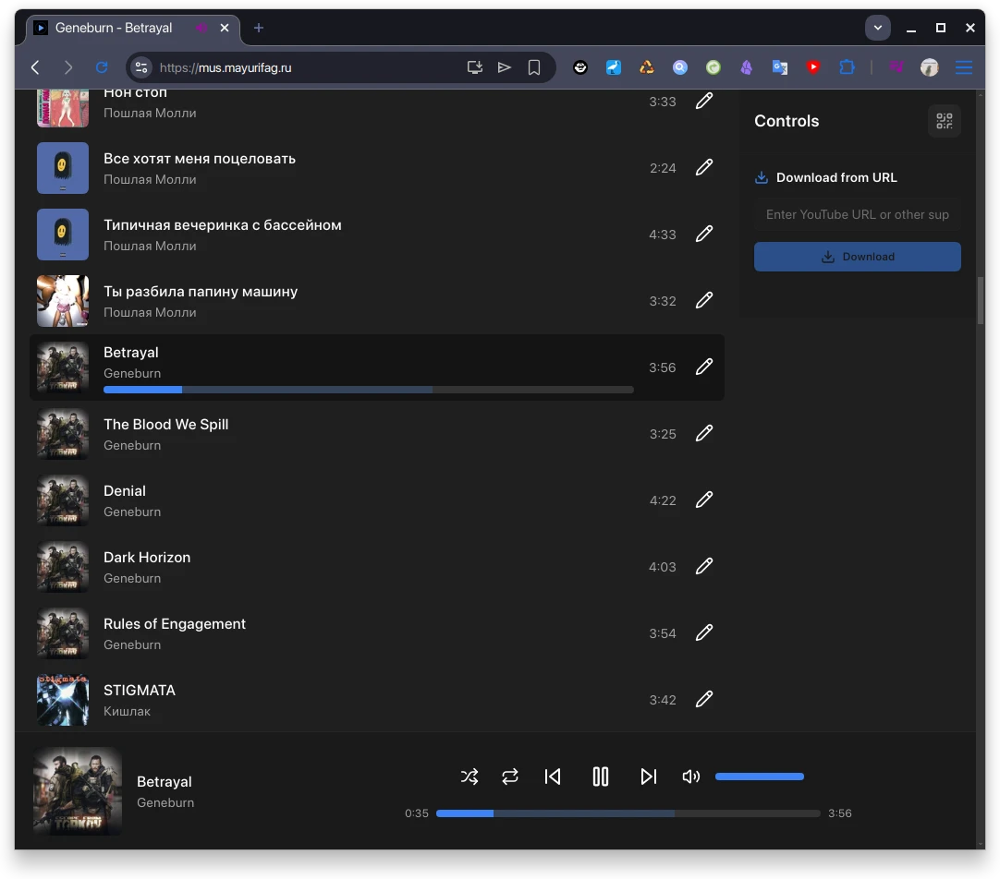

# mus

mus is a self-hosted music player, downloader, and library manager with a simple web interface for desktop and mobile.

**Status:** mus is used daily by its author, but it is not yet ready for general use. Setup instructions are not
available yet.

## Features

- Play music in your browser and repeat individual tracks. The app remembers the last track and position without
  starting playback automatically.
- Automatically discover files added to your music folder.
- Upload music or download it from YouTube and other supported sources, with SponsorBlock segment removal.
- Review and edit suggested artists, titles, and categories before downloading.
- Edit track artists, titles, artwork, and filenames.
- Remove parts of a track using a timeline, with previews and confirmation before saving.
- Show identical files as one library entry without deleting the extra copies.
- Disable actions that need write access when the music folder is read-only.

## Data and security

mus runs in a single Docker container. Mount your music folder at `/app_data/music` and persistent app data at
`/app_data/.cache`. Back up both.

**mus may rename files and update their metadata when scanning a writable music folder.** Editing changes the original
files, and cutting a track re-encodes lossy audio.

**mus has no built-in authentication.** Protect it with external authentication before exposing it.
